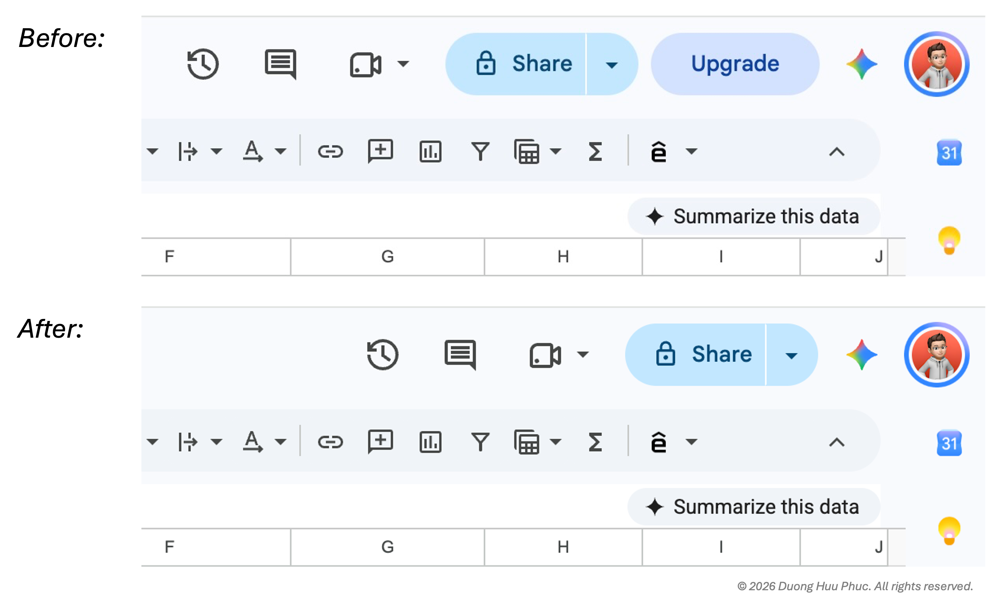

# Hide Google Workspace Upgrade Buttons

A lightweight Chrome extension built with Manifest V3 that hides unwanted **Upgrade** buttons, subscription prompts, and Gemini AI promotional elements across Google Workspace services.

## Preview



## Features

- **Cleaner interface:** Hides prominent Upgrade buttons and Google One subscription prompts.
- **Fewer AI promotions:** Hides selected Gemini AI promotional buttons and entry points.
- **Broad coverage:** Targets Google Drive, Docs, Sheets, Slides, Gmail, Calendar, and Chat.
- **Lightweight implementation:** Uses CSS injected at `document_start`, without a JavaScript content script.

## Supported Services

- Google Drive (`drive.google.com`)
- Google Docs, Sheets, and Slides (`docs.google.com`)
- Gmail (`mail.google.com`)
- Google Calendar (`calendar.google.com`)
- Google Chat (`chat.google.com`)

## Installation

The extension is not currently available on the Chrome Web Store. To install it locally:

1. Download or clone this repository. If cloning, use the repository's actual URL:

   ```bash
   git clone https://github.com/duonghuuphuc/hide-google-upgrade-extension.git
   ```

2. Open `chrome://extensions/` in Chrome (or the equivalent extensions page in Edge or Brave).
3. Enable **Developer mode**.
4. Select **Load unpacked**.
5. Choose the project directory containing `manifest.json`.

## File Structure

```text
├── manifest.json        # Manifest V3 extension configuration
├── style.css            # CSS rules for hiding targeted elements
├── icon/icon16.png      # 16×16 extension icon
├── icon/icon48.png      # 48×48 extension icon
├── icon/icon128.png     # 128×128 extension icon
└── README.md            # Project documentation
```

## How It Works

The extension injects `style.css` into matching Google Workspace pages at `document_start`, hiding targeted interface elements through CSS selectors.

For example, the stylesheet may include rules such as:

```css
/* Upgrade and subscription prompts */
#workspace-onegoogle-pep-container,
[aria-label*="Upgrade"],
a[href*="one.google.com/explore-plan"] {
  display: none !important;
}

/* Gemini promotional elements */
.appsElementsSidekickAuroraEntryPointRoot,
#docs-sidekick-gen-ai-promo-button-container {
  display: none !important;
}
```

Because Google Workspace interfaces change over time, selectors may need updating when elements are renamed or restructured.
